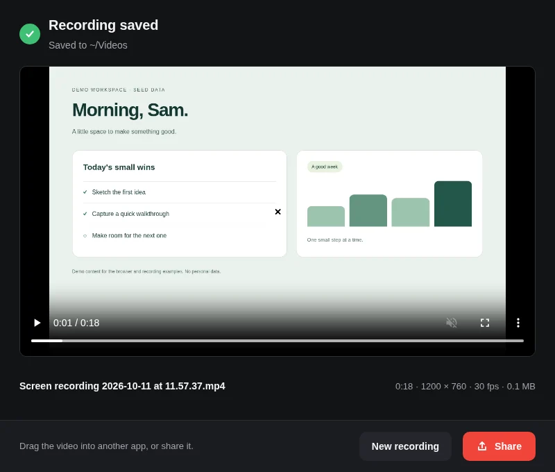
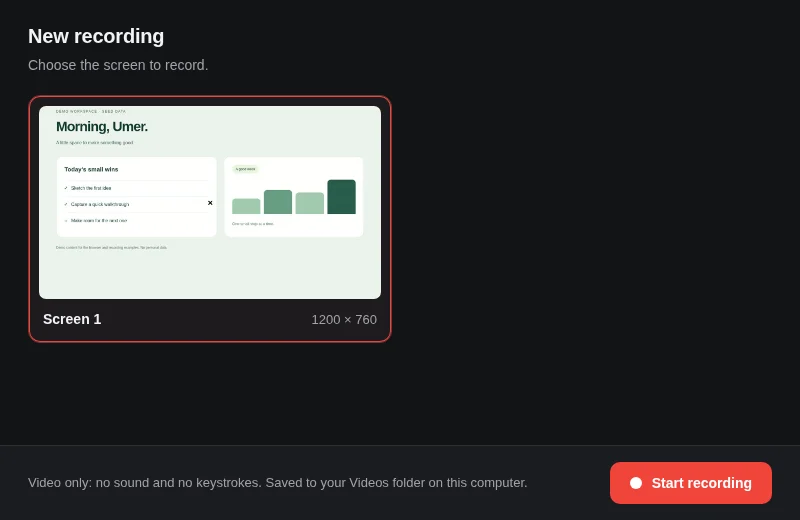
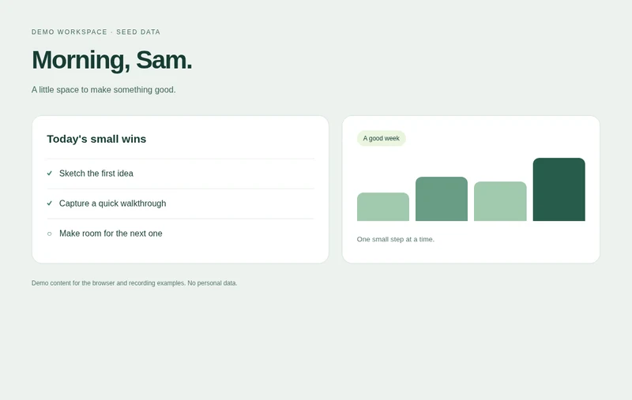
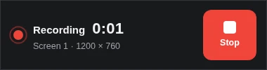

<p align="center">
  
</p>

<h1 align="center">Platform kits</h1>

<p align="center"><strong>Little building blocks. More capable apps.</strong><br>
Record a screen, capture a page, or keep a helpful action within reach.</p>

<p align="center">
  <a href="LICENSE"></a>
  <a href="#pick-your-kit"></a>
  <a href="examples/recorder"></a>
</p>

<p align="center">
  
  <br><sub>A real recording, saved on this computer. All screens below use demo data.</sub>
</p>

## Give your app a little more reach

The small things make an app feel useful: a quick recording, a button that stays nearby, a page saved as an image.
Pick the kit you need, keep your own interface, and leave the rest out. No AI account or model is required.

## A few things you can make

<table>
  <tr>
    <td width="50%"><br><strong>Pick a screen.</strong><br>A preview makes the choice clear.</td>
    <td width="50%"><br><strong>Keep a page.</strong><br>A browser capture, from local demo HTML.</td>
  </tr>
</table>

<p align="center">
  
  <br><sub>While you work: a small timer and one clear Stop button.</sub>
</p>

These are fresh captures from the built examples, not interface mockups. The recorder has a dark interface;
the light workspace is seeded content captured by the browser kit, not a second recorder theme.

## Try the recorder in three steps

From a clean checkout, with a JavaScript runtime **22.18+** and **npm** installed.
This example needs **Linux with an X11 display** and **ffmpeg** with `x11grab` and `libx264` support.

**1 · Install**

```sh
npm ci
```

**2 · Build the kits**

```sh
npm run build
```

**3 · Open the example**

```sh
node examples/recorder/server.ts
```

Open the local URL printed in the terminal. Choose **Screen 1 → Start recording → Stop**.
Your video lands in `~/Videos`. This example records video only: no sound or keystrokes.
Stop the server with `Ctrl+C` when you're finished.

Not on Linux X11? Start with the [browser kit](packages/browser) for page captures, or the
[native app example](examples/expo) for Android overlays and status-bar actions.

## Pick your kit

| | What it adds |
| --- | --- |
| **[overlay](packages/overlay)** | An Android bubble and panel, focused-field access, screen frames and point markers. |
| **[statusbar](packages/statusbar)** | An Android status-bar chip with actions and a lock-screen copy. |
| **[record](packages/record)** | Screen recording and video from an app-selected recorder. |
| **[browser](packages/browser)** | PNG captures of a URL, local HTML or one page element, in a private browser session. |
| **[speak](packages/speak)** | Platform text-to-speech. Private; not published yet. |
| **[social](packages/social)** | Draft, approve and post to your own accounts. Private; not published yet. |

Each kit has its own platform support and setup; its linked README is the contract.
Local recording and page capture need no subscription or API key. Account-based posting has its own requirements.

<details>
<summary><strong>Package versions</strong></summary>

| Package | Latest version | Capability |
|---|---|---|
| [@platform-kits/overlay](packages/overlay) | 0.3.2 | Android bubble, panel, focused field, screen frames and point markers |
| [@platform-kits/statusbar](packages/statusbar) | 0.1.2 | Android status-bar chip with actions and a lock-screen copy |
| [@platform-kits/record](packages/record) | 0.2.1 | Screen recording and video through recorder protocol v1 |
| [@platform-kits/speak](packages/speak) | 0.1.0, private | Platform text-to-speech |
| [@platform-kits/browser](packages/browser) | 0.1.1 | Isolated Chromium screenshots of URLs or local HTML |
| [@platform-kits/social](packages/social) | 0.1.0, private | Draft, approve and post to your own social accounts |

Each version matches that package's `package.json`. The two private kits are not available from the public registry.

</details>

## Make yourself at home

[Contributing](CONTRIBUTING.md) · [Capability contracts](docs/capability-kits.md) ·
[Kit conventions](docs/kit-conventions.md) · [Project history](docs/history/README.md) ·
[License](LICENSE)

Small, independent packages. Open source under Apache-2.0.
